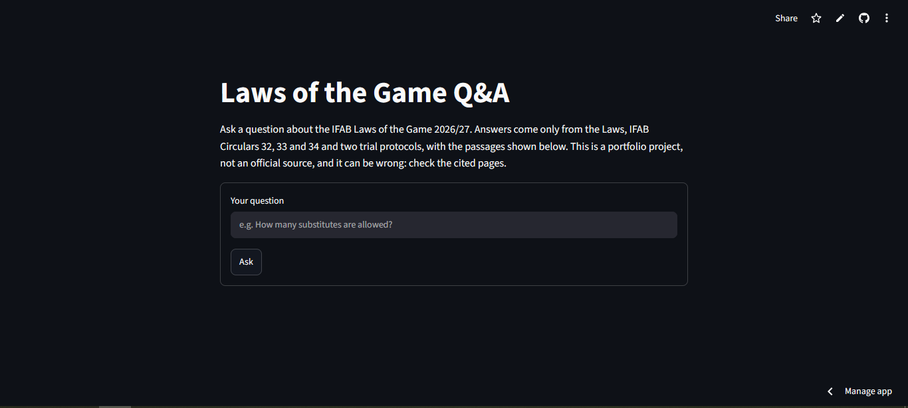

# Laws of the Game Q&A

A retrieval-augmented generation (RAG) demo that answers questions about the IFAB **Laws of the Game 2026/27**. Every answer is built only from the retrieved passages, which are shown next to it so the answer can be checked.

**Live demo:** https://laws-of-the-game-rag-jfwbcgzktfjpzuuyobpk2e.streamlit.app/

> This is a portfolio project, not an official source. It can be wrong. Check the cited pages in the Laws before relying on an answer.



## What it covers

| Document | Used for |
|---|---|
| Laws of the Game 2026/27 (the full book) | The Laws, the Law changes, the glossary, the guidelines |
| IFAB Circulars 32, 33 and 34 | AGM decisions, additional Law changes, clarifications |
| Two trial protocols | Tactical goalkeeper injuries; VAR review of attacking-team offences at set pieces |

Sources and where they come from: [SOURCES.md](data/SOURCES.md). Questions are answered in English only.

## How it works

```
PDFs → parse → clean → chunk → embed + index → retrieve → distance gate → generate → cited answer
```

| Stage | Script | What it does |
|---|---|---|
| Parse | `src/parse.py` | Extracts the text of each page with `pypdf` into `pages_raw.jsonl` (275 pages) |
| Clean | `src/clean.py` | Removes running footers, page numbers and letterheads, drops near-empty pages, and records each page's Law section |
| Chunk | `src/chunk.py` | Splits the text into 255 chunks (see below) |
| Index | `src/ingest.py` | Embeds the chunks with `BAAI/bge-small-en-v1.5` (384 dimensions) and stores them in a persistent Chroma index with cosine distance |
| Retrieve | `src/retrieve.py` | Embeds the question and returns the 4 nearest chunks |
| Answer | `src/rag.py`, `src/generate.py` | Applies the distance gate, then asks `openai/gpt-oss-120b` on Groq (OpenAI-compatible API, temperature 0) to answer from the numbered sources |
| Demo | `app.py` | Streamlit page that shows the answer and the retrieved passages |

Settings (model names, k, the gate, the refusal sentence) live in one place: `src/config.py`.

### Design choices

- **Hybrid chunking.** The Laws have a clear structure (Law, section, sub-section), so chunks follow headings first and are then capped at 1,500 characters. A chunk is merged with a too-short neighbour (minimum 300 characters), and a 200-character overlap is added only where a long block had to be split. The longest chunk is 409 tokens, under the embedding model's 512-token limit, so nothing is silently truncated.
- **Context for the embedding, not for the reader.** Each chunk is embedded with a breadcrumb in front (document, Law, section heading), but the stored and displayed text is the original.
- **Query instruction.** `bge` was trained with an instruction prefix on questions, so every question is embedded with it.
- **A distance gate.** If even the best chunk is farther than 0.32 (cosine distance), the app refuses without calling the model.
- **A prompt with strict source rules.** The model may use only the numbered sources, must refuse with a fixed sentence when they do not contain the answer, must cite source numbers, and must say when a source is a trial protocol and not part of the Laws. Incident questions get a structured answer (decision, applicable Law, analysis, referee judgment).

## Evaluation

The evaluation set is [`data/eval/questions.csv`](data/eval/questions.csv): 26 questions, each with an expected answer, source file and pages, and a difficulty. It has 21 answerable questions (6 easy, 9 medium, 6 hard), including one with a false premise and one aimed at the strikethrough problem described below, and 5 unanswerable ones. Four questions were held out from any tuning. [`src/eval.py`](src/eval.py) runs every question through the system and saves the results; the graded results are in [`data/eval/results_graded.csv`](data/eval/results_graded.csv).


### Retrieval

A relevant chunk (expected file, overlapping pages) was among the 4 retrieved for **19 of 21** answerable questions (90%): 16 of 18 on the development questions and 3 of 3 on the held-out ones. It was ranked first for 13 of 21 (62%). The two misses are described under *Failure examples*.

### Answers

Each answer is scored on three checks: **correct** (1, 0.5 for true but incomplete, or 0), **grounded** (no claim beyond the retrieved text) and **cited** (the cited source numbers support what is attributed to them). Unanswerable questions score only on a correct refusal. Questions are weighted by difficulty (1, 2 or 3; unanswerable 2). A refusal of an answerable question scores 0 for correct and for cited, with credit for grounded.

| Tier | Weighted score |
|---|---|
| Easy | 6.0 / 6 (100%) |
| Medium | 15.0 / 18 (83%) |
| Hard | 12.5 / 18 (69%) |
| Unanswerable | 10 / 10 (100%) |
| **Total** | **43.5 / 52 (84%)** |

Of the 21 answerable questions, 15 were fully correct, 2 were true but incomplete, and 4 were wrong or refused. All 5 unanswerable questions were refused: 2 by the distance gate and 3 by the model itself.

**Read these numbers with care.** There are only 26 questions, so one question moves the score by several points. The author graded the system, the questions were written with the source text open (so their wording may sit closer to the Laws than real users' questions would), and each question was run once. The same model can answer differently on a repeat run even at temperature 0. The score depends on the grading rules above; under stricter rules it comes out nearer 76%.

### Failure examples

- **A confident wrong rule.** Asked what happens if the ball touches the referee and goes into the goal, the system answered that the goal stands. Law 9 says the ball is out of play and play restarts with a dropped ball. The Law 9 passage was not retrieved. The closest passage was a Law 5 clause about extra balls, objects and animals, and the model treated the referee as an "object". It quoted that clause accurately, which makes the answer convincing. The sources panel shows the mismatch: the cited page is about animals and extra balls.
- **A vocabulary gap.** "What is the penalty for a player who dives to win a free kick?" was refused, because the passage that says "simulation" was not retrieved. Rephrased as "simulates a fall", the system gave the right verdict, but only by linking the glossary's definition of "deceive" to unsporting behaviour. The passage that states the rule outright was still not retrieved.
- **A typo.** "How many substitues are allowed?" was refused by the distance gate, because the misspelling moved the best distance from 0.225 to 0.362. The right passages were still ranked first.

## Known limitations

- **Diagrams and image-only pages are lost.** About 30 pages with images lose their diagram content, which probably includes the handball diagrams. Four pages were image-only and were dropped.
- **The Law-changes section is a redline.** Pages 167–192 show old and new wording together. Deleted words are struck through in the PDF, but text extraction keeps them as ordinary words, so a chunk can read "a maximum of six eight may be used". Chunks from this section reached the top four for 9 of 26 evaluation questions. It is left in for version 1.
- **The distance gate is a weak filter.** Answerable questions have best distances up to 0.31, while three of the five unanswerable ones sit at 0.21–0.28. The gate catches clearly off-topic questions and is sensitive to typos. The prompt does the rest of the refusing.
- **Retrieval distances are flat.** The top four are often within 0.01 of each other, so small wording changes reorder the results. Long list-like chunks and short chunks with several topics are hard to retrieve.
- **The model sometimes adds detail**, misapplies a nearby rule, or omits facts that were in the retrieved text. Citations sometimes appear as `【1†…】` and not `[1]`.
- **English only.** The embedding model is English-only.
- **Some extraction defects:** one page of the VAR trial protocol extracts badly, and Law 12 sub-headings are missing from the chunk metadata.
- **The IFAB documents are not covered by this repository's license** (see below).

## Run it yourself

```bash
git clone https://github.com/BillyGeros94/laws-of-the-game-rag.git
cd laws-of-the-game-rag
python -m venv .venv
source .venv/bin/activate        # Windows (Git Bash): source .venv/Scripts/activate
pip install -r requirements.txt
export GROQ_API_KEY="your-key"   # a free key from console.groq.com; never commit it
streamlit run app.py
```

The repository includes the built index, so the demo runs without rebuilding it. To rebuild from the PDFs, download the documents listed in [SOURCES.md](data/SOURCES.md) into `data/raw/` and run, in order:

```bash
python src/parse.py && python src/clean.py && python src/chunk.py && python src/ingest.py
```

Other commands:

```bash
python src/rag.py "How many substitutes are allowed in a match?"   # command line
python src/eval.py --retrieval-only    # retrieval hit rate only, no model calls
python src/eval.py                     # full evaluation; writes data/eval/results.csv
```

Changing the embedding model means changing `src/config.py` and re-running `src/ingest.py`.

## Notes

- **Shared quota.** The demo uses one free Groq key shared by all visitors, so it will sometimes answer that the service is busy. Try again later.
- **Privacy.** Questions you type are sent to Groq to generate the answer. Do not enter anything personal.

## License

The code in this repository is released under the [MIT License](LICENSE). The Laws of the Game and the IFAB circulars and protocols are published by The IFAB and are not covered by this license; they remain the property of their owner. See [SOURCES.md](data/SOURCES.md).
